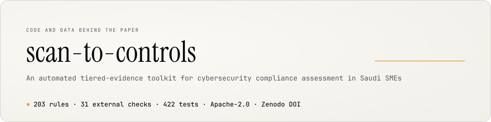

<picture>
  <source media="(prefers-color-scheme: dark)" srcset="docs/banner-dark.svg">
  
</picture>

# An automated tiered-evidence toolkit for cybersecurity compliance assessment in Saudi SMEs

Code and data behind the paper. Archived at [doi:10.5281/zenodo.22724989](https://doi.org/10.5281/zenodo.22724989),
which always resolves to the newest version; this is version 1.1.0.

[](https://doi.org/10.5281/zenodo.22724989)
[](LICENSE)


AlJasser AlGhamdi, Miada Almasre, Norah Al-Malki
King Abdulaziz University, Jeddah, Saudi Arabia
Contact: Miada Almasre, malmasre@kau.edu.sa

## What the paper asks

Saudi companies have to show they follow two national cybersecurity standards, ECC-2:2024 and NCNICC-1:2025. Between them that is 204 rules. Most small firms have nobody on staff to do the paperwork.

So the paper asks one question: how much of it can a single scan from outside the company answer by itself? The answer is 18 of the 204 rules, about one in eleven. The rest need somebody inside the company to look, or somebody to sign for it. Everything in this repository is the code and data behind that answer.

## What is in here

| Folder | Contents |
|---|---|
| `taxonomy` | All 204 rules. Each one is labelled in one of three ways: a scan can check it, someone inside the company has to check it, or somebody has to sign a statement for it. `taxonomy/release/text_manifest.json` holds a fingerprint of the Arabic text of every rule (see below). |
| `src` | The toolkit. Thirty-two checks that read what a company exposes to the internet, the table saying which rule each check speaks to, and the part that notices when a company claims something its own website contradicts. Every check has a working reader, and each one's written contract says what it reports, and when it reports nothing because it could not tell. |
| `evaluation` | The test runs and their results, as reported in the paper. |
| `scripts` | Helpers for re-running everything, and `verify_against_nca.py` (below). |
| `tests` | 639 tests. A few skip on a fresh copy, on purpose: they need the Arabic text or the private source records, neither of which ships, and the integration tests need the test servers running. |
| `test-target`, `scanner` | Small servers that answer with deliberately broken settings: expired certificates, weak keys, missing headers, open directory listings, leaked files, old software banners, an open zone transfer, missing email records, and so on. The paper reports how often the checks read these correctly (50 test endpoints), and this is how you re-measure it yourself. |

## Running it

You need Python 3.12 and [uv](https://docs.astral.sh/uv/).

```bash
make install      # fetch the dependencies
make test         # run the tests
make reproduce    # re-run the evaluation
make robustness   # re-run it under different assumptions
```

Nothing drifts between runs. Same seed, same numbers, every time.

To re-measure how well the checks read real servers, start the broken-on-purpose ones first (a web
server, a DNS server and a banner server, all on 127.0.0.1 only) and then point the matrix at them:

```bash
docker compose up -d test-matrix test-dns test-banner
uv run pytest -m integration
uv run python evaluation/run_detector_matrix.py
```

## The companies are not real

Scanning real companies without asking them first is not something we were willing to do, so the hundred companies in the evaluation are generated. Their sizes, sectors and web footprints come from Saudi national statistics, but no real company is in the data and none can be identified from it.

## What is not in here

The official Arabic wording of the two standards. That belongs to the National Cybersecurity Authority and we have not been given permission to redistribute it. You get the rule numbers, our labels, and the English wording the Authority already publishes openly (for the four NCNICC-1:2025 rows, which the Authority publishes in Arabic only, our own English rendering). The numbers match their documents, so anything can be looked up. For each rule the release also carries a SHA-256 fingerprint of the Arabic text we worked from, so anyone holding the Authority's documents can check our encoding row by row without our copying the text: copy the rows you want to check into a two-column file (`id`, `text`) and run

```bash
uv run python scripts/verify_against_nca.py --texts my_copy.csv
```

The part of the tool that scans live websites. It only runs after the site's owner has proven control of it and signed a consent, so it is not released. Nothing here needs them: the evaluation runs entirely on the generated companies and the local test servers.

## What changed in version 1.1.0

Every one of the 32 checks now has a working reader, measured on the local test servers. The score is redesigned: a control the scan could not read never passes, coverage is reported beside the score, and the documented score has a fixed denominator. The contradiction check is direction-sensitive and also reads internal-assessment records. The classification was re-read against its decision rules and the NCA implementation guide, and now covers 204 rows, 18 of them testable from outside. Also new: independent seeds for the thirty-seed analysis, a fingerprint of the Arabic text of every rule, an exposure sweep, the posture band, a direct check of the thirty-seed shortfall, the implemented-only slice, an audit of the best generic mapper, and a fix to the Arabic text normalisation. The exposed database and internal port checks now also map to 2-5-3-5 (restricting network services and ports). The package also installs from a fresh clone again (version 1.0.0 named a `README.txt` that does not exist).

## Licence

Apache 2.0. See [LICENSE](LICENSE) and [NOTICE](NOTICE).

## Cite this work

If you use these artefacts, please cite the article. The repository itself can be cited through its archive:

```bibtex
@software{alghamdi_2026_scan_to_controls,
  author    = {AlGhamdi, AlJasser and Almasre, Miada and Al-Malki, Norah},
  title     = {Tiered-evidence toolkit, control classification and evaluation artefacts for Saudi SME cybersecurity compliance},
  year      = {2026},
  version   = {1.1.0},
  publisher = {Zenodo},
  doi       = {10.5281/zenodo.22724989},
  url       = {https://doi.org/10.5281/zenodo.22724989}
}
```
